# IEM Admission System

An online college admission system built on the MEAN stack (MongoDB, Express,
Angular, Node.js). Applicants register, fill in an application, upload their
documents, submit and pay a (mock) fee. Administrators review applications,
record entrance scores and move each one through a fixed set of statuses, and
the applicant sees every decision on their own dashboard.

It is a proof of concept: a deliberately small slice of a real admissions
portal, built so that one full request-response loop works end to end and
every rule is enforced on the server.


| Applicant: uploads, with a rejected file | Admin: review, merit score and eligibility |
|---|---|
| 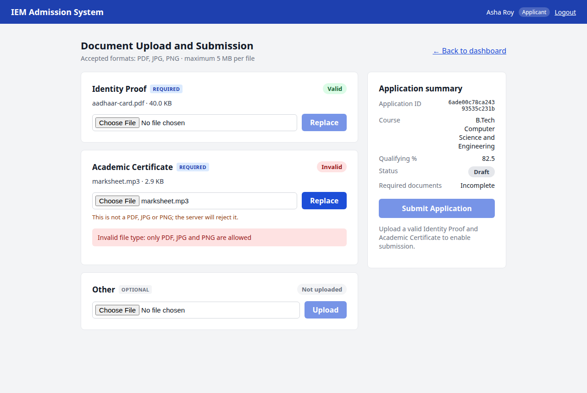 | 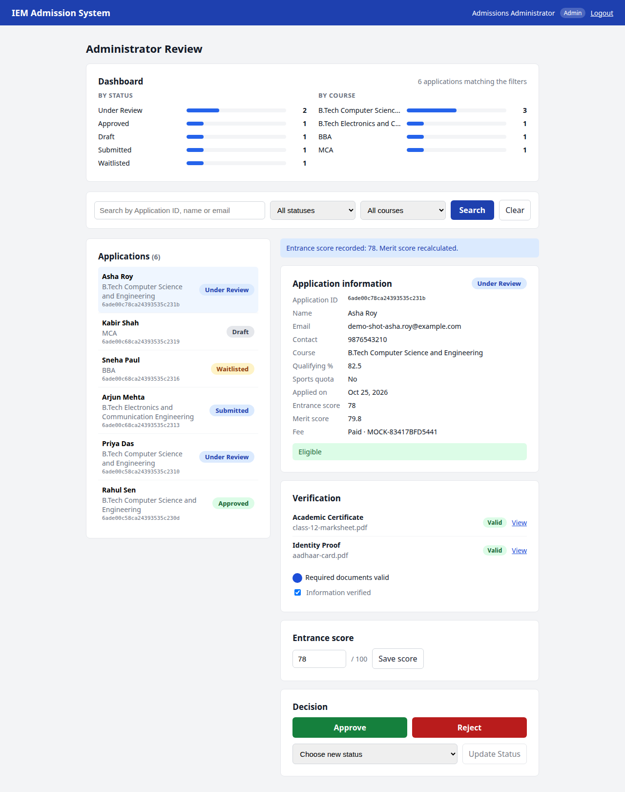 |

---

## Contents

1. [What it does](#what-it-does)
2. [Quick start](#quick-start)
3. [Full setup](#full-setup)
4. [Deploying to Vercel](#deploying-to-vercel)
5. [Walkthrough with screenshots](#walkthrough-with-screenshots)
6. [Architecture](#architecture)
7. [Data model](#data-model)
8. [Business rules](#business-rules)
9. [API reference](#api-reference)
10. [Security](#security)
11. [Testing](#testing)
12. [Project structure](#project-structure)
13. [Design decisions](#design-decisions)
14. [Troubleshooting and FAQ](#troubleshooting-and-faq)
15. [Known limitations and what I'd improve](#known-limitations-and-what-id-improve)
16. [Further documentation](#further-documentation)

---

## What it does

**Applicants**
- Register and log in. Every new account is an applicant; the API ignores a
  `role` field sent at registration.
- Pick a course and enter a qualifying-exam percentage (0–100) and a sports
  quota flag. This is saved as a **Draft** they can edit.
- Upload an Identity Proof, an Academic Certificate and an optional Other
  document. Each file is checked for type, size and real content; a rejected
  file gets one exact reason (e.g. `File too large — maximum allowed size is
  5 MB (your file is 5,242,881 bytes (5.000001 MB))`).
- Submit once both required documents are valid. Submitting creates a
  ₹1,000 fee record, which they mark paid with a mock payment.
- Track their status as the admin moves it along.

**Administrators**
- See counts by status and by course, computed by one MongoDB aggregation.
- Search applications by ID, name or email, and filter by status and course.
- Open an application to see the applicant's details, each document (and the
  file itself), the fee, the merit score and an eligibility verdict.
- Record an entrance score; the merit score is recalculated on the spot.
- Move the status forward. Only transitions the server allows are enabled,
  and the server refuses everything else with 409.

**Out of scope:** a real payment gateway, SMS/OTP, email (including password
reset), offer letters and admit cards, seat allotment, production deployment.

---

## Quick start

Needs Node.js 20+, npm and Docker.

```bash
git clone https://github.com/rue19/iem-admission.git
cd iem-admission
docker compose up -d                              # MongoDB 8.2 on port 27017

cd backend
npm install
cp .env.example .env                              # then set JWT_SECRET and ADMIN_PASSWORD
npm run seed                                      # admin account + 4 courses
npm run dev                                       # API on http://localhost:3000

# second terminal
cd frontend
npm install
npm start                                         # UI on http://localhost:4200
```

Open http://localhost:4200, register as an applicant, or log in with the
`ADMIN_EMAIL` / `ADMIN_PASSWORD` you put in `.env`.

---

## Full setup

### Prerequisites

| Tool | Version | Notes |
|---|---|---|
| Node.js | 20 or newer (developed on 24.18) | Includes npm |
| MongoDB | **8.2 or newer** | Docker, a local install or Atlas. MongoDB 8.0 and older refuse to start on Linux kernel 6.19+ ([SERVER-121912](https://jira.mongodb.org/browse/SERVER-121912)), which is why `docker-compose.yml` pins `mongo:8.2`. |
| Docker | any recent | Only if you use the bundled `docker-compose.yml` |

### 1. Database

Pick one:

- **Docker (recommended):** `docker compose up -d` from the repo root. Data
  lives in the named volume `iem-mongo-data`, so it survives restarts.
  `docker compose stop` stops it; `docker compose down -v` deletes the data.
- **Local install:** start `mongod`; the default `MONGO_URI` already points at
  `mongodb://127.0.0.1:27017/iem_admission`.
- **MongoDB Atlas free tier:** create a cluster, allow your IP, and put the
  `mongodb+srv://...` string in `MONGO_URI`.

### 2. Back end

```bash
cd backend
npm install
cp .env.example .env
```

Edit `backend/.env`:

| Variable | Required | Default | What it's for |
|---|---|---|---|
| `NODE_ENV` | no | `development` | |
| `PORT` | no | `3000` | API port |
| `MONGO_URI` | **yes** | — | Database connection string (`MONGODB_URI` is accepted too, which is the name Vercel's Atlas integration uses) |
| `JWT_SECRET` | **yes** | — | Signs login tokens. Use a long random value: `node -e "console.log(require('crypto').randomBytes(48).toString('hex'))"` |
| `JWT_EXPIRES_IN` | no | `2h` | Token lifetime |
| `CLIENT_ORIGIN` | no | `http://localhost:4200` | The only browser origin CORS allows |
| `STORAGE_DRIVER` | no | `disk` | `disk`: files go to `UPLOAD_DIR`. `blob`: files go to Vercel Blob (used on Vercel) |
| `UPLOAD_DIR` | no | `uploads` | Where uploaded files are written with the disk driver, relative to `backend/` |
| `BLOB_READ_WRITE_TOKEN` | with `blob` | — | Vercel Blob access. Vercel sets it when a Blob store is connected to the project. |
| `ADMIN_EMAIL` | for seed | — | Admin account created by `npm run seed` |
| `ADMIN_PASSWORD` | for seed | — | At least 8 characters |
| `MONGO_URI_TEST` | for tests | `.../iem_admission_test` | Test database. **Its name must end in `_test`**, because the tests wipe it. |

The server refuses to start if `MONGO_URI` or `JWT_SECRET` is missing, and
says which one.

Seed the database:

```bash
npm run seed
```

This creates (or updates) the admin account and four courses: B.Tech
Computer Science and Engineering, B.Tech Electronics and Communication
Engineering, BBA and MCA, each with a 60% minimum. It is safe to run again;
it updates instead of duplicating. **It is the only way to create an admin**,
since public registration always creates applicants.

Run the API:

```bash
npm run dev      # restarts on file changes (nodemon)
npm start        # plain node
```

Check it: `curl http://localhost:3000/api/health` returns
`{"status":"ok","db":"connected",...}`, or `503` with `"db":"disconnected"`
if MongoDB isn't reachable.

### 3. Front end

```bash
cd frontend
npm install
npm start        # ng serve on http://localhost:4200
```

The app calls the API at `/api` on its own origin
([`frontend/src/environments/environment.ts`](frontend/src/environments/environment.ts)).
Locally, `ng serve` forwards `/api` to `localhost:3000`
([`frontend/proxy.conf.json`](frontend/proxy.conf.json)); on Vercel both are
served from one domain. The same build works in both places.

### npm scripts

| Where | Script | Does |
|---|---|---|
| `backend/` | `npm run dev` | API with auto-restart |
| `backend/` | `npm start` | API |
| `backend/` | `npm run seed` | Admin + courses |
| `backend/` | `npm test` | All 350 back-end tests (needs MongoDB) |
| `backend/` | `npm run test:coverage` | Tests plus a coverage table |
| `frontend/` | `npm start` | Dev server on port 4200 |
| `frontend/` | `npm test` | Angular unit tests (`ng test`) |
| `frontend/` | `npm run build` | Production build into `frontend/dist/` |

---

## Deploying to Vercel

The whole system runs on Vercel as one project: Angular as static files, the
Express API as one serverless function, uploads in Vercel Blob, and the
database on MongoDB Atlas.

| Part | On Vercel | Configured by |
|---|---|---|
| Angular app | Static files from `frontend/dist/frontend/browser` | [`vercel.json`](vercel.json) `buildCommand`, `outputDirectory` |
| Express API | One serverless function, [`api/index.js`](api/index.js), for every `/api/*` request | `vercel.json` `rewrites` |
| Uploaded files | Private Vercel Blob store | `STORAGE_DRIVER=blob`, `BLOB_READ_WRITE_TOKEN` |
| Database | MongoDB Atlas | `MONGO_URI` or `MONGODB_URI` |

Two Vercel limits shaped the code:
- **No lasting disk.** Files can't go to `uploads/`, so the `blob` storage
  driver stores them in Vercel Blob as **private** blobs. MongoDB still holds
  only a reference (`blob:applications/<id>/<uuid>.pdf`).
- **Request and response bodies are capped at 4.5 MB.** A 5 MB file can't pass
  through the API, so on Vercel uploads go straight from the browser to Blob,
  in three steps:
  1. `POST /api/applications/me/documents/blob-token`: the API checks login,
     ownership, the Draft status and the **file type**, then issues an upload
     token that Blob enforces at **5,242,880 bytes**.
  2. The browser uploads to Blob with that token.
  3. `POST /api/applications/me/documents/blob`: the API reads the real size
     and first bytes from Blob, applies Rule DU, records the result, and
     deletes the file if it's invalid.

  Rule DU therefore holds on Vercel too, in the same order: type, then size,
  then readability. Admins open files through 5-minute signed links
  (`GET /api/admin/documents/:id/link`), so files never pass through a
  function either.

### Steps

1. **Push the repo to GitHub** (already done for `rue19/iem-admission`).
2. **Create the Vercel project:** import the repository at vercel.com/new, or
   run `vercel link` in the repo root. Keep the root directory as the repo
   root; `vercel.json` sets the install, build and output settings.
3. **Add a database:** in the project's **Storage** tab, add **MongoDB Atlas**
   from the Marketplace (it sets `MONGODB_URI`). Or create a free Atlas
   cluster yourself, allow access from `0.0.0.0/0`, and add `MONGO_URI`.
4. **Add file storage:** in **Storage**, create a **Blob** store and connect it
   to the project (it sets `BLOB_READ_WRITE_TOKEN`).
5. **Set environment variables** (Settings → Environment Variables):

   | Variable | Value |
   |---|---|
   | `STORAGE_DRIVER` | `blob` |
   | `JWT_SECRET` | a new long random value, not your local one |
   | `NODE_ENV` | `production` |

6. **Deploy:** push to `main` (with the Git integration) or run
   `vercel --prod`.
7. **Seed the live database** once, from your machine:
   ```bash
   cd backend
   MONGO_URI='<the Atlas connection string>' JWT_SECRET=unused \
   ADMIN_EMAIL='admin@your-domain' ADMIN_PASSWORD='<a strong password>' \
   npm run seed
   ```
8. Open the deployment URL, check `/api/health` says `"db":"connected"`, then
   register and run through the flow.

Locally nothing changes: `STORAGE_DRIVER` defaults to `disk`, and the tests
cover both drivers (`blobUploads.test.js` runs the API in `blob` mode).

---

## Walkthrough with screenshots

These screenshots come from a scripted run in headless Chrome against the
real API and database, which also checked each step.

**1. Log in or register.** After login the app sends applicants to
`/dashboard` and admins to `/admin`, based on the role the server returned.

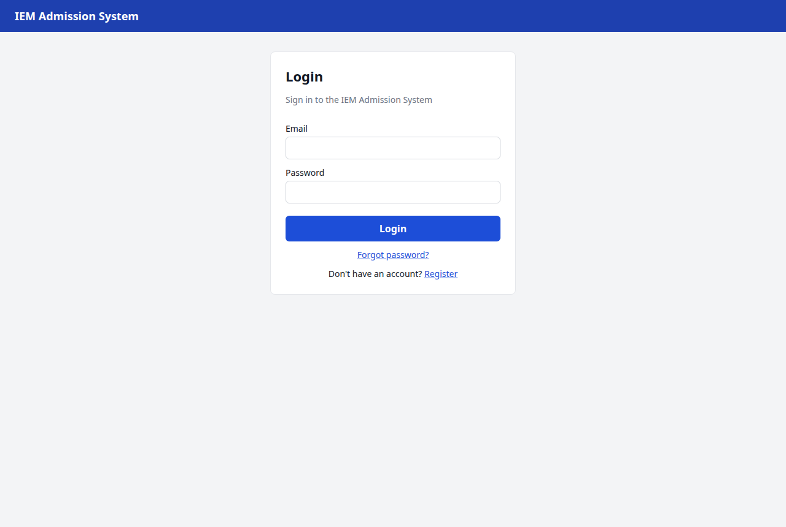

**2. Create the application.** Choose a course, enter the qualifying
percentage and save. The badge shows **Draft**, and the checklist ticks off
what's done.

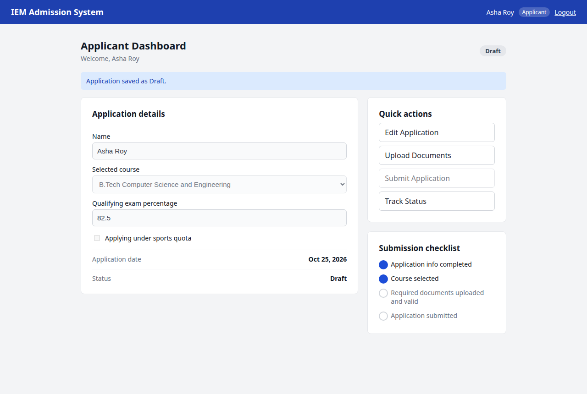

**3. Upload documents.** Each slot shows Valid, Invalid with the server's
reason, or Not uploaded. Submit stays disabled until both required
documents are valid.


**4. Submit.** After replacing the bad file, Submit works. The status
becomes **Submitted**, and the Application ID is shown.

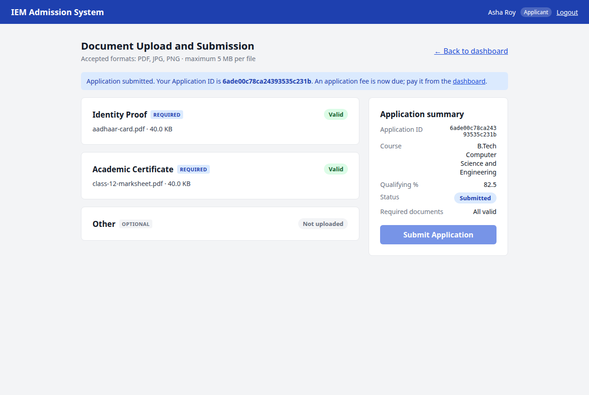

**5. Pay the fee (mock).** The fee card goes from Pending to Paid with a
`MOCK-...` reference. No payment details are collected.

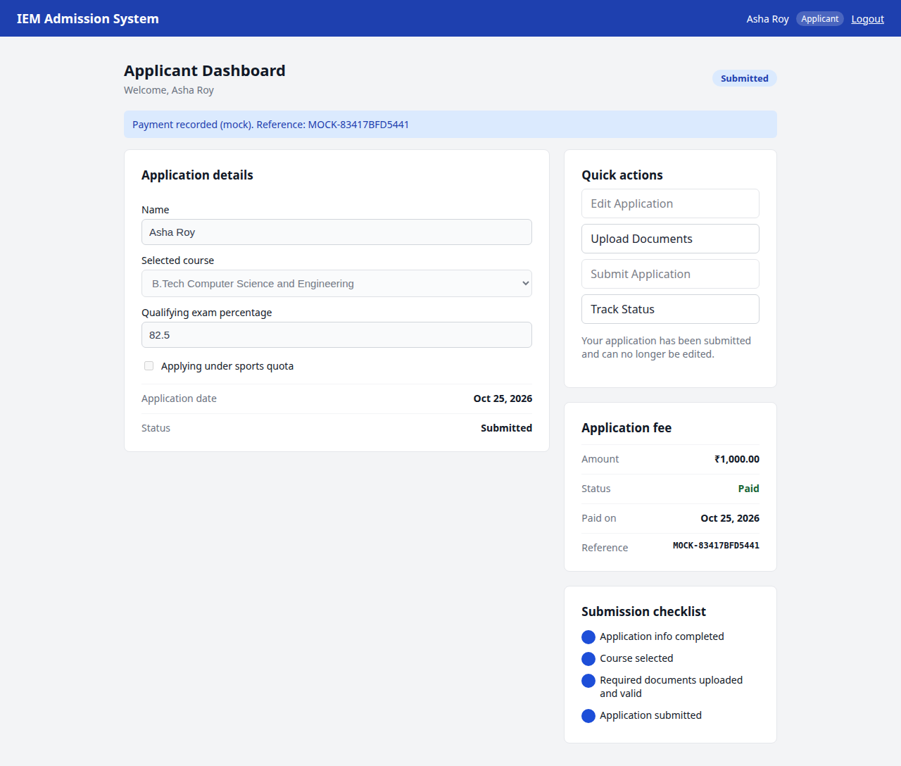

**6. Admin review.** The dashboard block counts applications by status and
course. Selecting an application shows its details, documents (with
**View**), fee, entrance score, merit score and eligibility. Here the admin
has moved it to Under Review, recorded a score of 78 (merit 79.8) and ticked
"Information verified".


**7. Decide.** After **Approve**, every decision button is disabled, because
Approved is final.

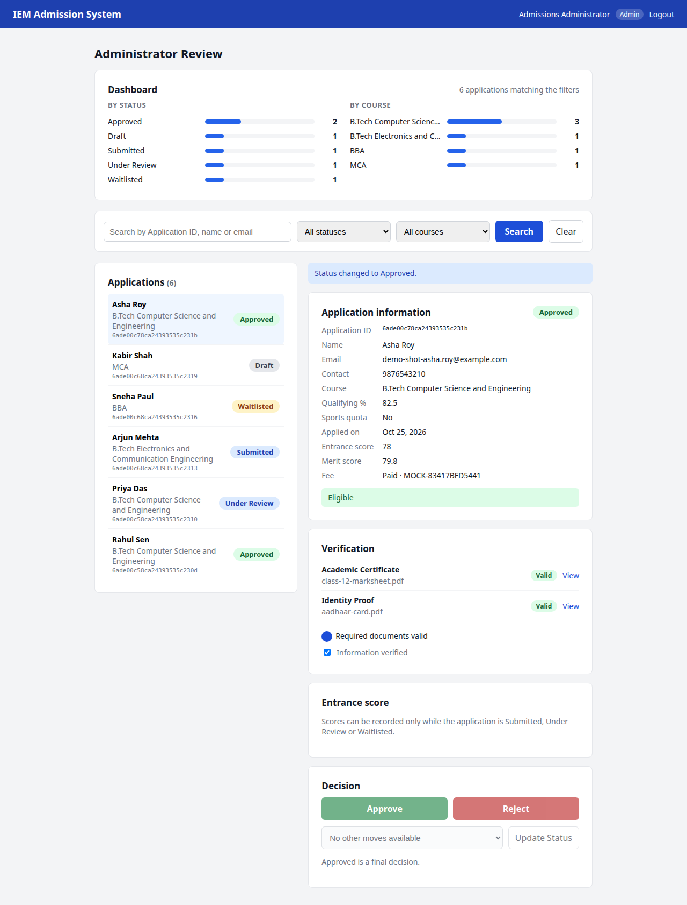

**8. The applicant sees it.** Logging back in, the badge says **Approved**.

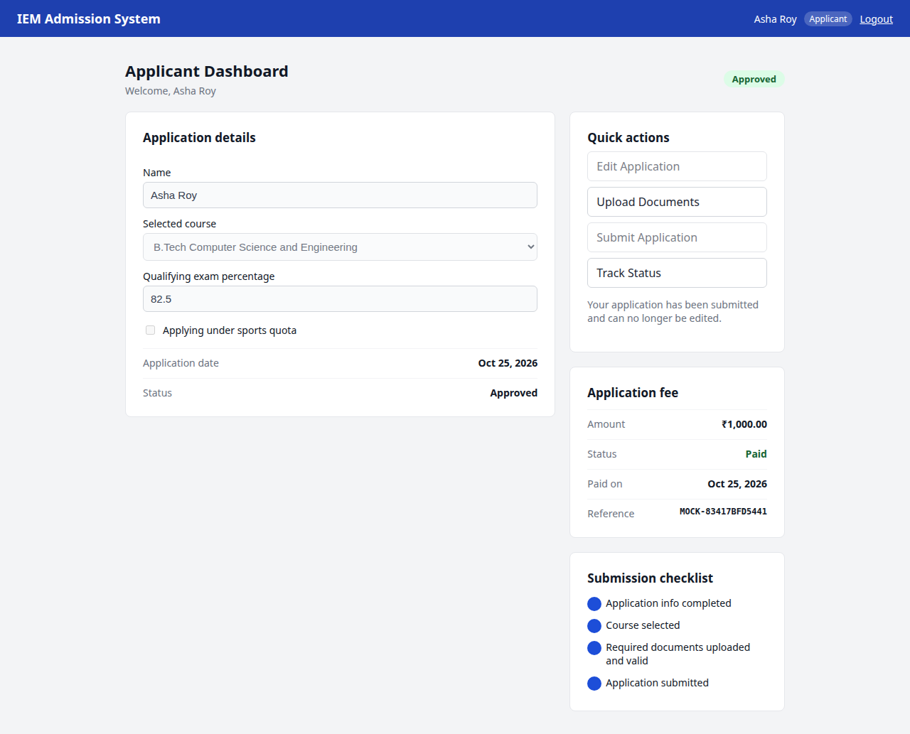

---

## Architecture

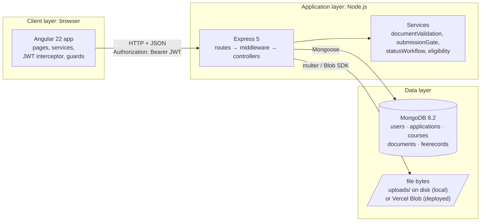

| Layer | Technology | Responsibility |
|---|---|---|
| Client | Angular 22: standalone components, signals, Router, HttpClient, Reactive Forms | What the user sees. Guards and form checks here are for convenience only; the server re-checks everything. |
| Application | Express 5 on Node.js | Routing, authentication (`verifyToken`), authorisation (`requireRole`), input validation (zod), business rules (`services/`) |
| Data | MongoDB via Mongoose 9 | Five collections, one per data store in the DFD (D1–D5). Uploaded file bytes go to disk locally, or to private Vercel Blob storage when deployed; MongoDB holds only metadata and a reference. |

The eight application modules from the HLD map onto the code like this:

| HLD module | Where it lives |
|---|---|
| Account Management | `routes/auth.js`, `controllers/authController.js`, `middleware/auth.js`, `middleware/requireRole.js` |
| Application Management | `routes/applications.js`, `controllers/applicationController.js` |
| Course Selection and Management | `routes/courses.js`, `controllers/courseController.js`, `scripts/seed.js` |
| Document Management | `middleware/upload.js`, `controllers/documentController.js`, `services/storage.js` |
| Application and Document Validation | `services/documentValidation.js`, `services/submissionGate.js`, `validators/*` |
| Application Submission and Status | `submitMyApplication` in `applicationController.js`, `services/statusWorkflow.js` |
| Fee Record Management | `routes/fees.js`, `controllers/feeController.js` |
| Application Review (admin) | `routes/admin.js`, `controllers/adminController.js`, `services/eligibility.js` |

### One request, start to finish

Here is the **submit** flow, the request-response loop the project is built
around:

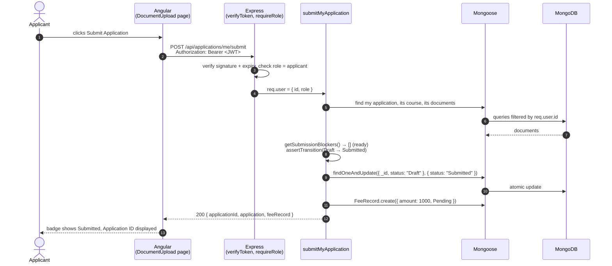

In six steps, with the code for each (also in the
[demo cheat-sheet](docs/DEMO_CHEATSHEET.md)):

1. **Angular** (`document-upload.ts`, `application.service.ts`): the button
   calls `ApplicationService.submit()`, which POSTs an empty JSON body. The
   interceptor adds `Authorization: Bearer <token>`.
2. **HTTP/JSON** crosses to the server; CORS allows it because it comes from
   `CLIENT_ORIGIN`.
3. **Express on Node** (`routes/applications.js`): `verifyToken` checks the
   JWT and sets `req.user`, `requireRole('applicant')` checks the role, and the
   route hands over to `submitMyApplication`.
4. **Mongoose**: the controller loads the application by `req.user.id`, runs
   the submission gate and the workflow check, then does one conditional
   `findOneAndUpdate` and creates the fee record.
5. **MongoDB** applies the update atomically: it only matches if the status is
   still `Draft`.
6. **JSON back to Angular**: `{ applicationId, application, feeRecord }`. The
   component sets its signals and the page re-renders with the new status.

---

## Data model

Five collections, one per data store in the DFD. All have `createdAt` and
`updatedAt` (Mongoose `timestamps: true`).

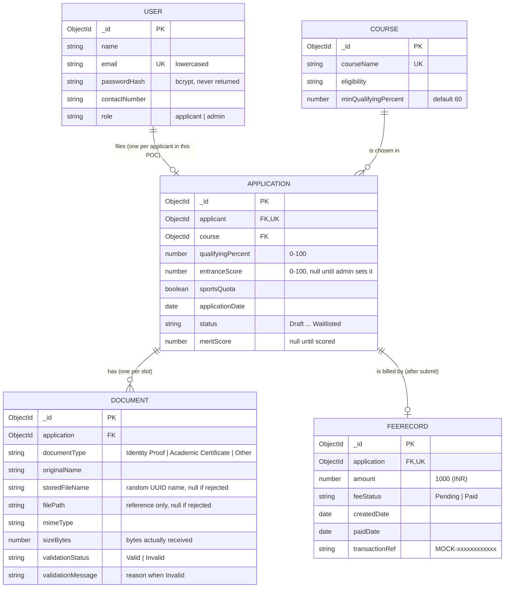

| Collection | DFD store | Notes |
|---|---|---|
| `users` | D1 | Applicant and Administrator from the class diagram are one collection with a `role` field, since they share every field. `passwordHash` has `select: false` and is also stripped from all JSON. |
| `applications` | D2 | A unique index on `applicant` enforces one application per applicant at the database level. |
| `courses` | D3 | Seeded. |
| `documents` | D4 | Metadata and a file path only, never the file bytes. A unique index on `{ application, documentType }` keeps one current document per slot. `filePath` and `storedFileName` are never sent to the browser. |
| `feerecords` | D5 | A unique index on `application` gives one fee per application. Created on submit. |

Status names live in one file,
[`backend/src/config/constants.js`](backend/src/config/constants.js), so
renaming (say) Approved to Selected is a one-line change.

---

## Business rules

All of these run on the server. The Angular app mirrors some of them only to
enable or disable buttons.

### Document upload (Rule DU)

`backend/src/services/documentValidation.js`

A file is accepted only if all three hold. They are checked in this order,
and only the **first** failure is reported:

| # | Check | Message when it fails |
|---|---|---|
| 1 | Extension is PDF, JPG/JPEG or PNG | `Invalid file type: only PDF, JPG and PNG are allowed` |
| 2a | Size is not 0 | `File is empty` |
| 2b | Size ≤ 5,242,880 bytes (5 × 1,048,576, inclusive) | `File too large — maximum allowed size is 5 MB` plus the exact size, e.g. `(your file is 5,242,881 bytes (5.000001 MB))` |
| 3 | First bytes match the type: PDF `%PDF`, JPG `FF D8 FF`, PNG `89 50 4E 47` | `File is corrupted or unreadable` |

Details that matter:
- The size is the number of bytes multer actually wrote, never a size the
  client claims. multer stops reading at the limit, so a huge file is never
  fully written.
- `checkFileSize()` works on raw bytes. A negative, fractional, NaN,
  infinite or non-numeric size throws `Invalid file size` (400); it can't
  come out as "valid".
- The size is shown with six decimals so a file one byte over the limit
  doesn't display as "5.00 MB".
- Files are stored as `<random-uuid>.<ext>`. The user's file name is never
  used in a path, which rules out `../../` tricks and name collisions.
- Every rejected file is deleted. A file over 5 MB is cut off by multer
  partway through and its partial file deleted, and an upload aborted
  mid-transfer is cleaned up too. Tests DOC-06 and DOC-20 check the upload
  folder is empty afterwards.
- A rejected upload leaves a small `Invalid` record with the reason (no file),
  so the page can show it and submission stays blocked until a corrected
  file replaces it.
- On Vercel the same checks run in the same order, split across the
  direct-to-Blob flow: type when the upload token is requested, size enforced
  by Blob through the token's 5,242,880-byte cap, and size plus readability
  re-checked from storage on confirmation. See
  [Deploying to Vercel](#deploying-to-vercel).

### Submission gate

`backend/src/services/submissionGate.js`

`POST /api/applications/me/submit` succeeds only if:
- the status is `Draft`;
- a course is selected and still exists;
- `qualifyingPercent` is a number from 0 to 100;
- Identity Proof and Academic Certificate are both uploaded and **Valid**.
  "Other" is optional and never blocks.

Otherwise it returns **400** with `error` (the first reason) and `reasons`
(all of them), and nothing changes. On success the status becomes `Submitted`,
a `Pending` fee record of ₹1,000 is created, and the Application ID comes
back.

### Status workflow

`backend/src/services/statusWorkflow.js`

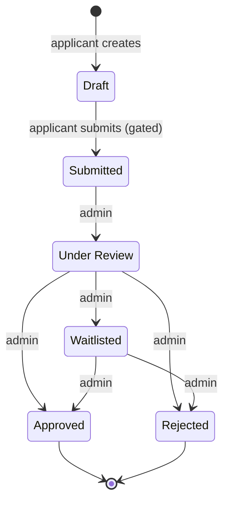

The map lists who may make each move. Anything not on the map is refused with
**409**: skipping a step, going backwards, setting the same status again,
leaving Approved or Rejected, an admin submitting a Draft, or an applicant
making any admin move. The tests check all 36 from/to pairs. Applicants can't
write `status` at all: the update endpoint rejects the field, and submit
ignores its body.

### Eligibility and merit

`backend/src/services/eligibility.js`

An application is **eligible** only if qualifying % ≥ 60, entrance score ≥ 50
(out of 100) and the fee is Paid. When more than one condition fails, one
message is reported, in this order:

| Order | Failing condition | Message |
|---|---|---|
| 1 | Fee not paid | `Application incomplete: fee payment pending` |
| 2 | No entrance score yet | `Application incomplete: entrance score not recorded` |
| 3 | Entrance score < 50 | `Not eligible: entrance score below qualifying cutoff.` |
| 4 | Qualifying % < 60 | `Not eligible: qualifying percentage below minimum requirement.` |

**Merit score:**

```
score = 0
if entranceScore >= 50:
    score = qualifyingPercent * 0.4 + entranceScore * 0.6
    if sportsQuota: score += 5
    if score > 100: score = 100
return round(score, 2 decimals)
```

Rounding is there because binary floating point gives
`77.7*0.4 + 66.6*0.6 = 71.03999999999999`. The merit score is stored when the
admin records the entrance score. Eligibility is computed on every request
instead, because it depends on the fee, which changes independently.

### Fees

A ₹1,000 fee record is created on submit. `POST /api/fees/me/pay` is a mock:
it reads no amount or card details and simply marks the fee Paid with a
`MOCK-<12 hex>` reference. Paying twice gives 409. Paying does not change the
application's status; it only feeds eligibility.

---

## API reference

Base URL: `http://localhost:3000/api`. Every response is JSON.

**Auth:** every route except health, register and login needs
`Authorization: Bearer <token>`. Tokens come from register or login, hold
`{ id, role }`, and expire after `JWT_EXPIRES_IN` (2 hours by default).

**Errors** always look like `{ "error": "message" }`. Validation errors add
`"field"`, and a refused submit adds `"reasons": [...]`.

### Endpoints

| Method and path | Who | What it does |
|---|---|---|
| `GET /health` | anyone | `200 { status: "ok", db: "connected" }`, or `503` with `db: "disconnected"` |
| `GET /config` | anyone | `{ uploadMode: "disk" \| "blob", maxUploadBytes }`, which tells the app how to upload |
| `POST /auth/register` | anyone | `{ name, email, password, contactNumber? }` → `201 { token, user }`. Always creates an applicant. |
| `POST /auth/login` | anyone | `{ email, password }` → `{ token, user }`. The same 401 for an unknown email and a wrong password. |
| `GET /auth/me` | logged in | The account the token belongs to |
| `GET /courses` | logged in | All courses, sorted by name |
| `POST /applications` | applicant | `{ course, qualifyingPercent, sportsQuota? }` → `201` Draft. A second application → 409. |
| `GET /applications/me` | applicant | My application with the course populated; 404 if not started |
| `PUT /applications/me` | applicant | Partial update of course, qualifyingPercent, sportsQuota. Draft only (409 otherwise). Any other field → 400. |
| `POST /applications/me/documents` | applicant | **Disk driver.** Multipart: `file` + `documentType` (`Identity Proof`, `Academic Certificate`, `Other`). 201 if valid; 400 with the reason and the Invalid record if not. Draft only. |
| `POST /applications/me/documents/blob-token` | applicant | **Blob driver.** Called by the `@vercel/blob` client: checks ownership, Draft status and type, and returns an upload token capped at 5,242,880 bytes |
| `POST /applications/me/documents/blob` | applicant | **Blob driver.** `{ documentType, pathname, originalName }` after the upload: checks the stored file and records it (201), or deletes it (400 with the reason) |
| `GET /applications/me/documents` | applicant | `{ documents, requiredTypes }` |
| `POST /applications/me/submit` | applicant | Gated submit → `{ applicationId, application, feeRecord }`; 400 with `reasons` if not ready |
| `GET /fees/me` | applicant | My fee record; 404 before submitting |
| `POST /fees/me/pay` | applicant | Mock payment: Pending → Paid. 409 if already paid. |
| `GET /admin/dashboard?status=&course=` | admin | `{ total, byStatus, byCourse, byCourseAndStatus }` from one aggregation |
| `GET /admin/applications?status=&course=&q=` | admin | List, newest first (max 200). `q` matches an Application ID, or part of a name or email (case-insensitive, matched literally). |
| `GET /admin/applications/:id` | admin | `{ application, documents, feeRecord, allowedNextStatuses, eligibility }` |
| `PATCH /admin/applications/:id/status` | admin | `{ status }`, checked against the workflow. Illegal → 409. |
| `PATCH /admin/applications/:id/entrance-score` | admin | `{ entranceScore }` (0–100). Only while Submitted, Under Review or Waitlisted. Recalculates `meritScore`. |
| `GET /admin/documents/:id/file` | admin | Disk driver: the uploaded file, served inline. 404 for a rejected upload (no file kept). |
| `GET /admin/documents/:id/link` | admin | Blob driver: `{ url, expiresAt }`, a signed link valid for 5 minutes |

Admin query strings are strict: an unknown parameter is a 400 rather than
being silently ignored.

### Status codes

| Code | Meaning here |
|---|---|
| 200 / 201 | OK / created |
| 400 | Failed validation, sent a field the caller may not set, or the application isn't ready to submit |
| 401 | No token, a bad or expired token, or wrong login details |
| 403 | Logged in, but the role isn't allowed on this route |
| 404 | Doesn't exist, or doesn't exist *for you* (e.g. no application yet) |
| 409 | Conflicts with the current state: duplicate email, second application, editing after Draft, illegal status change, fee already paid, someone else changed it first |
| 413 | JSON body over 100 KB |
| 500 | Unexpected error. The body is always just `{ "error": "Internal server error" }`. |
| 503 | Health check only: the database is down |

### Examples

```bash
API=http://localhost:3000/api

# Register (role is ignored) and keep the token
TOKEN=$(curl -s -X POST $API/auth/register -H 'Content-Type: application/json' \
  -d '{"name":"Asha Roy","email":"asha@example.com","password":"secret123","role":"admin"}' \
  | node -pe 'JSON.parse(require("fs").readFileSync(0)).token')
AUTH="Authorization: Bearer $TOKEN"

# Pick the first course and create a Draft
COURSE=$(curl -s $API/courses -H "$AUTH" | node -pe 'JSON.parse(require("fs").readFileSync(0)).courses[0]._id')
curl -s -X POST $API/applications -H "$AUTH" -H 'Content-Type: application/json' \
  -d "{\"course\":\"$COURSE\",\"qualifyingPercent\":82.5}"

# Upload documents (multipart)
curl -s -X POST $API/applications/me/documents -H "$AUTH" \
  -F 'documentType=Identity Proof' -F 'file=@./aadhaar.pdf'
curl -s -X POST $API/applications/me/documents -H "$AUTH" \
  -F 'documentType=Academic Certificate' -F 'file=@./marksheet.pdf'

# Submit, then pay
curl -s -X POST $API/applications/me/submit -H "$AUTH"
curl -s -X POST $API/fees/me/pay -H "$AUTH"
```

A refused submit:

```json
{
  "error": "Academic Certificate is invalid (File is empty). Upload a corrected file",
  "reasons": ["Academic Certificate is invalid (File is empty). Upload a corrected file"]
}
```

An illegal admin move:

```bash
curl -s -X PATCH $API/admin/applications/<id>/status -H "Authorization: Bearer $ADMIN_TOKEN" \
  -H 'Content-Type: application/json' -d '{"status":"Approved"}'
# {"error":"Illegal status change: Submitted → Approved"}   (HTTP 409)
```

A dashboard response:

```json
{
  "total": 6,
  "byStatus": [{ "_id": "Under Review", "count": 2 }, { "_id": "Approved", "count": 1 }],
  "byCourse": [{ "_id": "6ade…", "courseName": "BBA", "count": 1 }],
  "byCourseAndStatus": [{ "course": "6ade…", "courseName": "BBA", "status": "Waitlisted", "count": 1 }]
}
```

The aggregation behind it, next to its SQL equivalent:

| SQL | MongoDB stage |
|---|---|
| `WHERE status = ? AND course = ?` | `$match` (only when filters are given) |
| `GROUP BY status` with `COUNT(*)` | `$group: { _id: '$status', count: { $sum: 1 } }` |
| `JOIN courses ON ...` | `$lookup: { from: 'courses', ... }` |
| several `GROUP BY` queries | `$facet`: all of them in one round trip |

---

## Security

The rule throughout: **the server decides; the browser only displays.** Every
check in Angular (guards, form validators, disabled buttons) is repeated on the
server, and the tests call the API directly to prove it.

| Concern | How it's handled | Tests |
|---|---|---|
| Passwords | bcrypt, cost 10. Never returned: `select: false` plus a `toJSON` strip. 8–72 characters (bcrypt ignores bytes after 72). | AUTH-02, AUTH-03, SEC-28 |
| Account discovery | Login gives the same 401 for an unknown email and a wrong password. | AUTH-07 |
| Tokens | JWT signed with HS256 (algorithm pinned, so `alg: none` is refused). It carries only `{ id, role }` and expires after 2 hours by default. Editing the payload breaks the signature. | AUTH-08..11, SEC-24..27 |
| Role escalation | Registration has no `role` field (zod drops it), so admins only come from the seed script. Roles come only from the verified token. | SEC-03, SEC-23 |
| Admin routes | `verifyToken` + `requireRole('admin')` on the whole `/api/admin` router, so even unknown admin URLs give 403 to an applicant. | SEC-02, SEC-10 |
| Other people's data | Applicant routes have no `:id`; every query filters by `req.user.id`. There is no way to name someone else's application, documents or fee. | SEC-01 |
| Server-owned fields | `status`, `entranceScore`, `meritScore` and `applicant` sent by an applicant → 400 (zod `.strict()`). | SEC-05, SEC-06, SEC-11 |
| Race conditions | Edit, submit, pay and admin status changes are conditional atomic updates, so double clicks and two admins at once succeed exactly once. | SUB-07, ADM-15 |
| Injection | zod requires strings where strings are expected, so `{ "$ne": null }` never reaches MongoDB. Search text is regex-escaped. Unknown query parameters → 400. | SEC-20, SEC-21, ADM-07 |
| Uploads | Type, size and magic-byte checks; random file names; files outside the upload folder can't be served; `nosniff` on downloads; rejected and partial files deleted. | DOC-*, ADM-30..32 |
| Uploads on Vercel | Private blobs. Upload tokens are only issued for the caller's own application folder, with a random UUID name, and capped at 5,242,880 bytes. Size and content are re-read from storage, never trusted from the browser. Admins get 5-minute signed links. | BLOB-03..20, STORE-* |
| Information leaks | No stack traces in responses, no `X-Powered-By`, file paths never sent to the browser. | SEC-29, SEC-30, DOC-01 |
| Browser origin | CORS allows only `CLIENT_ORIGIN`. JSON bodies are capped at 100 KB. | SEC-31, SEC-22 |
| Secrets | `.env` is git-ignored; only `.env.example` is committed. | |

---

## Testing

```bash
cd backend && npm test               # 350 tests, 14 suites, ~15 s (MongoDB must be running)
cd backend && npm run test:coverage  # same, plus a per-file coverage table
cd frontend && npm test              # 18 Angular unit tests (Vitest)
```

Back-end tests run against `MONGO_URI_TEST`, which is wiped between tests.
The helper refuses to touch a database whose name doesn't end in `_test`.
Uploads during tests go to a temporary folder, never `backend/uploads/`.

**Coverage** (back end, last run): 97.4% of statements, 91.2% of branches,
98.9% of functions, 97.7% of lines. The few uncovered lines are startup and
defensive branches, such as the database-connection log and `requireRole`
being used without `verifyToken`.

### Suites

| Suite | Tests | What it covers |
|---|---|---|
| `documentValidation.test.js` | 52 | Rule DU as pure functions: size boundaries, every path, precedence, messages, magic bytes |
| `statusWorkflow.test.js` | 62 | All 36 status pairs, who may move what, the submission gate |
| `eligibility.test.js` | 22 | The 8-row eligibility table, boundaries, every merit path |
| `health.test.js` | 3 | Health route, 404 JSON, malformed JSON |
| `auth.test.js` | 17 | Register, login, tokens, `requireRole` |
| `applications.test.js` | 25 | Courses, Draft create/read/update, ownership |
| `documents.test.js` | 25 | Real multipart uploads, rejections, disk cleanup, replacement, an aborted upload |
| `submission.test.js` | 21 | Submit gating, fee creation, mock payment |
| `admin.test.js` | 55 | Admin list/search/filter, review, transitions, scores, file download, admin-only access |
| `dashboard.test.js` | 20 | Aggregation counts and filters, stored merit, eligibility verdicts |
| `security.test.js` | 16 | Injection, token tampering, information leaks, CORS, body size |
| `e2e.test.js` | 1 | The whole Definition of Done through the API |
| `blobUploads.test.js` | 24 | The Vercel upload flow (`STORAGE_DRIVER=blob`): token cap and ownership, type refused before upload, size and readability from storage, cleanup, signed links |
| `storage.test.js` | 7 | The storage service against a mocked Blob SDK: delete, head, reading only the first bytes, signed links |

Test names start with an ID (`DU-BV-06`, `SUB-04`, `SEC-02`, ...), so a
failing test points straight at the test-plan item. The full index is in
[`docs/DEVELOPMENT_LOG.md`](docs/DEVELOPMENT_LOG.md#test-index).

### Test plan traceability

Every item in section 11 of the project brief, and the test that covers it:

| Test-plan item | Test IDs |
|---|---|
| File size −1 byte → invalid size | DU-BV-01 |
| 0 bytes → empty | DU-BV-02, DOC-08 |
| 1; 5,242,879; 5,242,880 → accept | DU-BV-03..05, DOC-03 |
| 5,242,881; 8,808,038 → reject | DU-BV-06..07, DOC-07, DOC-06 |
| NaN, Infinity, −Infinity, "5MB" → invalid size, never Valid | DU-BV-10..13 |
| 2,147,483,648 and 4,294,967,296 → too large, not empty | DU-BV-08..09, DU-BV-17 |
| validateDocument: invalid type / oversized / unreadable / valid | DU-P-01..04 |
| Precedence: MP3 + 8 MB + unreadable → "Invalid file type" | DU-PR-01, DOC-10 |
| Merit (70, 40, false) = 0; (70, 70, false) = 70; (70, 70, true) = 75; (95, 100, true) = 100 | MERIT-01..04, MERIT-INT-01..04 |
| Eligibility decision table, all 8 rows | ELIG-1..8 |
| Upload valid PDF accepted | DOC-01 |
| MP3 rejected | DOC-05 |
| 8.4 MB rejected and removed from disk | DOC-06 |
| Submit blocked while a document is invalid | SUB-02 |
| Submit succeeds and creates a Pending FeeRecord | SUB-04 |
| Re-upload after correction enables submit | SUB-05, DOC-16 |
| Applicant A can't read or modify B's application or documents | SEC-01 (four suites) |
| Applicant gets 403 on every `/api/admin/*` route | SEC-02 |
| Forged `role` in register is ignored | SEC-03 |
| Illegal status transitions rejected | WF-02..06, ADM-12..13 |
| Status can't be set through the applicant update endpoint | SEC-05, SEC-11 |
| Definition of Done, full cycle | E2E-01 |

### Front-end tests

| Spec | Checks |
|---|---|
| `auth.guards.spec.ts` | Logged-out → `/login`; wrong role → own home; an expired token counts as logged out; `guestGuard` |
| `auth.interceptor.spec.ts` | Token added to API calls only, never to other sites; a 401 clears the session, except on the login form |
| `document.service.spec.ts` | The "required documents valid" rule that enables Submit |
| `status-badge.spec.ts` | Status → CSS class |
| `app.spec.ts` | The shell renders |

### Browser check

The screenshots above came from a headless-Chrome run that clicked through
the whole flow against the real API and checked each step. That includes the
guard sending an applicant away from `/admin`, Submit staying disabled while a
document is invalid, and Approve being disabled until the application is
Under Review. The run had no JavaScript errors. The browser console does show
the API's deliberate 404s for "no application yet" on a new account (see the
FAQ).

---

## Project structure

```
iem-admission/
├── docker-compose.yml               MongoDB 8.2 for local development (not used on Vercel)
├── README.md
├── package.json                     root manifest for Vercel (Node version)
├── vercel.json                      Vercel build, output and /api rewrite
├── .vercelignore
├── api/
│   └── index.js                     Vercel serverless entry: connect once, hand requests to Express
├── docs/
│   ├── DEVELOPMENT_LOG.md           every file explained, phase by phase; full test index
│   ├── DEMO_CHEATSHEET.md           the submit flow through all six steps, with line numbers
│   ├── WRITEUP_OUTLINE.md           outline for the 1–2 page write-up
│   └── screenshots/                 images used in this README
├── backend/
│   ├── .env.example                 template for backend/.env (git-ignored)
│   ├── package.json                 scripts: dev, start, seed, test, test:coverage
│   ├── scripts/seed.js              admin account + 4 courses (idempotent)
│   ├── uploads/                     uploaded files (git-ignored, kept by .gitkeep)
│   ├── src/
│   │   ├── server.js                connect to MongoDB, then listen
│   │   ├── app.js                   the Express app: CORS, JSON, routes, errors (no listen)
│   │   ├── config/
│   │   │   ├── env.js               validated settings from .env
│   │   │   ├── db.js                connect / disconnect / status
│   │   │   └── constants.js         roles, statuses, fee statuses, fee amount
│   │   ├── models/                  User, Course, Application, Document, FeeRecord
│   │   ├── validators/              zod schemas: auth, application, document, admin
│   │   ├── middleware/
│   │   │   ├── auth.js              verifyToken
│   │   │   ├── requireRole.js
│   │   │   ├── validate.js          runs a zod schema on body or query
│   │   │   ├── upload.js            multer: random names, 5 MB limit
│   │   │   └── errorHandler.js      one { error } shape for everything
│   │   ├── services/                pure business rules
│   │   │   ├── documentValidation.js
│   │   │   ├── submissionGate.js
│   │   │   ├── statusWorkflow.js
│   │   │   ├── eligibility.js
│   │   │   └── storage.js           where file bytes live: disk or Vercel Blob
│   │   ├── controllers/             auth, course, application, document, fee, admin
│   │   ├── routes/                  health, config, auth, courses, applications, fees, admin
│   │   └── utils/httpError.js
│   └── tests/                       14 Jest suites + helpers (test DB, test users)
└── frontend/
    ├── proxy.conf.json               ng serve: forward /api to localhost:3000
    └── src/
        ├── environments/environment.ts   API base URL
        ├── styles.css                    shared grey/blue styles
        └── app/
            ├── app.ts / app.html         shell: top bar + router outlet
            ├── app.routes.ts             routes and their guards
            ├── app.config.ts             router, HttpClient + interceptor
            ├── core/                     AuthService, interceptor, guards, ConfigService,
            │                             Application/Document/Fee/Admin services, models
            ├── pages/
            │   ├── login/  register/
            │   ├── applicant-dashboard/
            │   ├── document-upload/
            │   └── admin-review/
            └── shared/                   status badge, API error helpers
```

---

## Design decisions

**One `users` collection with a `role` field.** The class diagram has
Applicant and Administrator inheriting from User. They have identical fields,
so two collections would only duplicate login code.

**One application per applicant.** A brief-sanctioned simplification. A unique
index enforces it, so it holds even if two create requests race.

**Applicant routes use `/me`, never `/:id`.** If an applicant can't name an
application, they can't ask for someone else's. This removes a whole class of
access-control bugs instead of checking for them on every route.

**Business rules as pure functions in `services/`.** Document validation, the
submission gate, the workflow and eligibility take plain values and return
decisions. That makes them easy to test exhaustively (36 status pairs, all
size boundaries) and easy to explain, since none of them touch HTTP or the
database.

**Atomic conditional updates instead of check-then-write.** Each state change
puts its precondition in the query (`{ _id, status: 'Draft' }`). MongoDB
applies it only if the condition still holds, so two simultaneous requests
can't both win. A standalone MongoDB has no multi-document transactions, so
the one two-step write (submit, then create the fee) puts the status back if
the second step fails.

**Rejected uploads keep a metadata record but no file.** The spec says invalid
files must not stay in storage, but the page needs to show why a slot is
invalid and submission must stay blocked. So the file is deleted, and a small
`Invalid` record with the reason is kept until a corrected file replaces it.

**`.strict()` where the caller must not add fields, `strip` where the spec
says "ignore".** A forged `role` at registration is dropped silently, as the
brief asks. An applicant sending `status` on update gets a clear 400.

**Eligibility computed, merit stored.** Merit depends only on values that are
frozen after submission, so it is stored when the score is entered.
Eligibility also depends on the fee, which changes separately, so it is worked
out on each request.

**One storage switch instead of two code bases.** `STORAGE_DRIVER` picks disk
(local, tests) or Vercel Blob (deployed). Only `services/storage.js` and the
two upload entry points differ; every Rule DU check, the replace-and-delete
logic and the records are shared. The browser asks `/api/config` which mode
is active, so one Angular build serves both.

**Plain JavaScript on the back end, TypeScript on the front end.** The brief
allowed either for the back end. CommonJS with no build step keeps every file
directly runnable and easy to walk through in a demo.

**No extra libraries beyond the brief.** Express, Mongoose, multer, bcryptjs,
jsonwebtoken, zod, dotenv and cors on the server; Angular alone on the client.
The UI uses under 200 lines of hand-written CSS rather than a component library.

---

## Troubleshooting and FAQ

| Symptom | Fix |
|---|---|
| `MongoDB cannot start: Linux kernel versions 6.19 ...` in the container logs | Use MongoDB 8.2 or newer (the compose file already does). |
| `Missing required environment variable: JWT_SECRET` | `cp backend/.env.example backend/.env` and fill it in. |
| `GET /api/health` returns 503 | MongoDB isn't running or `MONGO_URI` is wrong. `docker compose up -d`. |
| The UI says "Cannot reach the server" | Start the API: `cd backend && npm run dev`. |
| Tests fail with `Missing required sub-document 'driver'` | Run them with `npm test`, not bare `npx jest`. See below. |
| `Refusing to run tests against non-test database` | Make `MONGO_URI_TEST` end in `_test`. |
| `ExperimentalWarning: VM Modules` when testing | Expected; see below. |
| Login works but `/admin` bounces you to `/dashboard` | You're logged in as an applicant. Admins only come from `npm run seed`. |
| Forgot the admin password | Change `ADMIN_PASSWORD` in `.env` and run `npm run seed` again. |
| Vercel: `/api/health` says the database is unavailable | Check `MONGO_URI`/`MONGODB_URI` in the project settings, and that Atlas allows access from `0.0.0.0/0`. |
| Vercel: uploads fail with "Upload failed" | Check that a Blob store is connected (`BLOB_READ_WRITE_TOKEN` set) and `STORAGE_DRIVER=blob`. |

**Why does `npm test` use `--experimental-vm-modules`?** MongoDB's Node driver
(7.x) loads Node's `os` module with a dynamic `import()`. Jest only supports
dynamic imports with that Node flag. Without it, the driver sends an empty
handshake and every connection fails with "Missing required sub-document
'driver'". The flag prints a harmless warning.

**Why are there 404s in the browser console for a new account?**
`GET /applications/me`, `/applications/me/documents` and `/fees/me` return 404
until the applicant has an application or a fee. The app treats those as
"not started yet", which is the correct REST answer, but browsers log every
4xx response in the console anyway.

**Why does an admin need to tick "Information verified" before Approve?**
It is the reviewer's own checklist and lives only in the browser. Nothing is
stored, and the server doesn't require it. It's there to match the wireframe.

**Can an applicant change anything after submitting?** No. Editing and
uploading both return 409 once the status leaves Draft.

---

## Known limitations and what I'd improve

- **Login rate limiting.** There is none, so passwords could be brute-forced.
  I'd add per-IP and per-account throttling.
- **Token revocation.** A token stays valid until it expires, even if the
  account is deleted or its role changes. `/auth/me` re-checks the account,
  but other routes trust the token. Short-lived access tokens plus refresh
  tokens would fix this.
- **Token storage.** The JWT is in `localStorage`, which any script on the page
  can read. An httpOnly, SameSite cookie is safer against XSS.
- **Audit trail.** Status changes overwrite the status with no record of who
  changed it or when. A `statusHistory` array would give a full history.
- **Transactions.** Submit uses a hand-written rollback because standalone
  MongoDB has no multi-document transactions. On a replica set (Atlas has one),
  I'd use a real transaction.
- **File storage.** Locally, files sit on the API server's disk. The Vercel
  deployment uses Blob storage, but there's no virus scanning or
  per-application size quota yet.
- **Unconfirmed uploads on Vercel.** If a browser uploads to Blob and then never
  calls the confirmation step (the tab is closed mid-way), that blob stays in
  storage unrecorded. A scheduled job that deletes blobs with no matching
  Document record would clean these up.
- **Pagination.** The admin list returns at most 200 rows. Real use needs
  pagination.
- **One application per applicant.** The data model would allow more if the
  unique index were removed and the routes took an application id.
- **Front-end test depth.** The Angular tests cover guards, the interceptor and
  shared logic. Page components are checked only by the browser run, which
  isn't part of the repository because it needs Playwright.

---

## Further documentation

- [`docs/DEVELOPMENT_LOG.md`](docs/DEVELOPMENT_LOG.md): how the project was
  built in eight phases (0–7), what every file does and why, the full test index,
  and the problems hit along the way.
- [`docs/DEMO_CHEATSHEET.md`](docs/DEMO_CHEATSHEET.md): a script for the lab
  demo. It walks one submit request through all six steps of the loop, with
  file and line references, and lists likely questions.
- [`docs/WRITEUP_OUTLINE.md`](docs/WRITEUP_OUTLINE.md): an outline and fact
  sheet for the 1–2 page write-up.

Built as a lab project on the MEAN stack. Development was assisted by Claude
(Anthropic); commits carry a `Co-Authored-By` trailer.
